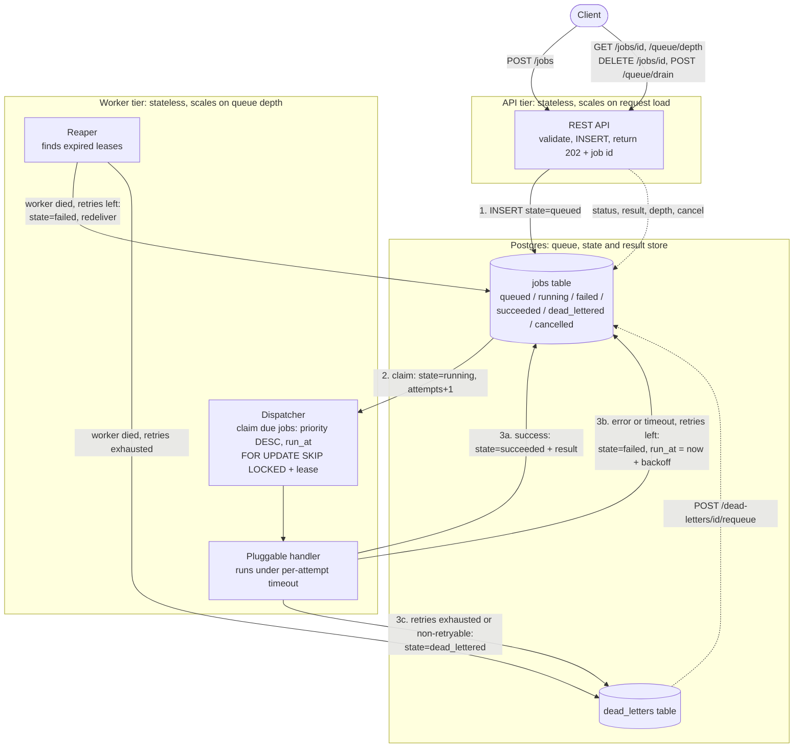

# Async Job Processing Service

A REST API backed by a durable asynchronous job queue. Callers submit work and get a job ID back
immediately; a separate pool of workers executes it with per-job priority, retry and timeout settings, and
the API exposes the full lifecycle of every job.

- **Java 21, Spring Boot 3, PostgreSQL 16.** Postgres is the queue, the result store and the dead-letter
  store. There is no separate broker.
- **API and workers are the same image run in different roles**, so the two tiers scale independently.

## Contents

- [Architecture](#architecture)
- [Quick start](#quick-start)
- [API](#api)
- [Worker configuration](#worker-configuration)
- [Writing a handler](#writing-a-handler)
- [Delivery semantics](#delivery-semantics-at-least-once)
- [Handling high load](#handling-high-load)
- [Observability](#observability)
- [Testing and CI](#testing-and-ci)
- [Deployment on DigitalOcean](#deployment-on-digitalocean)
- [Limitations and next steps](#limitations-and-next-steps)

## Architecture



The job state machine and the reasoning for a single store are in [docs/architecture.md](docs/architecture.md).

How a job moves:

1. **Submit.** The API validates the request, inserts one row with state `queued` and returns `202` with
   the job ID. That insert is the only work on the request thread.
2. **Claim.** A worker claims the highest-priority due jobs with `SELECT ... FOR UPDATE SKIP LOCKED`, so
   concurrent workers never block on, or receive, the same row. Claiming sets state `running`, increments
   `attempts` and takes a lease of `timeout + lease-grace`.
3. **Run.** The handler runs under the per-attempt timeout.
   - Success: state `succeeded`, result stored on the row.
   - Error or timeout with retries left: state `failed`, claimable again after an exponential back-off.
   - Retries exhausted, or a non-retryable error: state `dead_lettered`, and a row is written to the
     `dead_letters` table in the same SQL statement.
4. **Worker crash.** Nothing reports back, so the lease expires. The reaper (a small loop in every worker)
   requeues the job, or dead-letters it if its retry budget is spent.

| State | Meaning | Terminal |
|---|---|---|
| `queued` | Waiting for its first attempt, possibly delayed until `runAt` | no |
| `running` | An attempt is in flight under a lease | no |
| `failed` | The last attempt failed; a retry is scheduled at `runAt` | no |
| `succeeded` | Handler returned; result stored | yes |
| `dead_lettered` | Retries exhausted or non-retryable; copy in the dead-letter store | yes |
| `cancelled` | Cancelled or drained before it ran | yes |

## Quick start

Requirements: JDK 21, Maven 3.9+, PostgreSQL 14+ (or Docker).

### Option A: Postgres installed locally (works inside a dev container)

```bash
sudo apt-get update && sudo apt-get install -y postgresql
./scripts/dev-db.sh            # starts Postgres, creates database "jobs", password "postgres"
mvn spring-boot:run            # API + workers in one process on :8080
```

### Option B: Docker Compose (API and workers as separate services)

```bash
docker compose up --build                 # 1 API + 2 workers + Postgres
docker compose up -d --scale worker=5     # scale the worker tier only
```

### Try it

```bash
# Submit: returns 202 and the job immediately
curl -s -X POST localhost:8080/api/v1/jobs -H 'Content-Type: application/json' \
  -d '{"type":"echo","payload":{"msg":"hello"},"priority":5,"maxRetries":3,"timeoutSeconds":10}' | jq

# Status and result
curl -s localhost:8080/api/v1/jobs/<id> | jq

# A job that fails twice and then succeeds (watch attempts climb)
curl -s -X POST localhost:8080/api/v1/jobs -H 'Content-Type: application/json' \
  -d '{"type":"flaky","payload":{"failTimes":2}}' | jq

# A job that always fails: ends up dead-lettered
curl -s -X POST localhost:8080/api/v1/jobs -H 'Content-Type: application/json' \
  -d '{"type":"flaky","payload":{"failTimes":99},"maxRetries":2}' | jq
curl -s localhost:8080/api/v1/dead-letters | jq

# A job that exceeds its timeout
curl -s -X POST localhost:8080/api/v1/jobs -H 'Content-Type: application/json' \
  -d '{"type":"sleep","payload":{"ms":60000},"timeoutSeconds":2,"maxRetries":1}' | jq

curl -s localhost:8080/api/v1/queue/depth | jq
```

Three example handlers ship with the service: `echo`, `sleep` and `flaky`.

## API

Base path `/api/v1`. Errors are RFC 7807 problem documents.

### Jobs

| Method | Path | Purpose | Responses |
|---|---|---|---|
| `POST` | `/jobs` | Submit a job | `202` created, `200` idempotent replay, `400`, `413`, `429` |
| `GET` | `/jobs/{id}` | State, attempts, last error, result | `200`, `404` |
| `GET` | `/jobs?state=&limit=` | List recent jobs, optionally by state | `200`, `400` |
| `DELETE` | `/jobs/{id}` | Cancel a job that has not started (also `POST /jobs/{id}/cancel`) | `200`, `404`, `409` |

Submit body:

| Field | Type | Default | Notes |
|---|---|---|---|
| `type` | string | required | Selects the handler |
| `payload` | any JSON | `null` | Passed to the handler; at most 256 KB |
| `priority` | 0..100 | 0 | Higher runs first; ties go to the oldest |
| `maxRetries` | 0..25 | 3 | Retries after the first attempt, so total attempts = `maxRetries + 1` |
| `timeoutSeconds` | 1..3600 | 30 | Limit for each attempt |
| `runAt` | ISO-8601 instant | now | Run no earlier than this time |
| `delaySeconds` | integer | 0 | Run no earlier than this many seconds from now |

Optional header `Idempotency-Key: <string>`: a repeated submission with the same key returns the original
job with `200` and does not create a second one.

Status response (abridged):

```json
{
  "id": "6f1c0a5e-...",
  "type": "flaky",
  "state": "failed",
  "attempts": 2,
  "maxRetries": 3,
  "timeoutSeconds": 30,
  "priority": 0,
  "runAt": "2026-01-15T12:00:04.1Z",
  "lastError": "IllegalStateException: simulated transient failure on attempt 2",
  "result": null,
  "createdAt": "...", "startedAt": "...", "finishedAt": null
}
```

### Visibility and operational control

| Method | Path | Purpose |
|---|---|---|
| `GET` | `/queue/depth` | `ready`, `delayed`, `retrying`, `running`, `deadLettered`, `pending`, `oldestReadyAgeSeconds`, `paused` |
| `POST` | `/queue/pause` | Workers stop claiming; submissions are still accepted; running jobs finish |
| `POST` | `/queue/resume` | Workers resume claiming |
| `POST` | `/queue/drain?type=` | Cancel every pending job, optionally of one type; returns `{"cancelled": n}` |
| `GET` | `/dead-letters?limit=` | Contents of the dead-letter store |
| `POST` | `/dead-letters/{jobId}/requeue` | Put a dead-lettered job back on the queue with a fresh retry budget |

Typical incident sequence: `pause`, inspect `depth` and `dead-letters`, `drain` the bad job type, `resume`.

Delayed execution: set `runAt` or `delaySeconds` on submit and the job is not claimed before that time.

The API has no authentication. Put it behind a gateway, and restrict the queue and dead-letter endpoints
to operators, before exposing it.

## Worker configuration

One artifact, two switches that select the role:

| Role | `JOBS_API_ENABLED` | `JOBS_WORKER_ENABLED` |
|---|---|---|
| All-in-one (default, for development) | true | true |
| API tier | true | false |
| Worker tier | false | true |

Settings (environment variable, or the matching `jobs.*` property in `application.yml`):

| Variable | Default | Meaning |
|---|---|---|
| `JOBS_DB_URL` / `JOBS_DB_USER` / `JOBS_DB_PASSWORD` | `jdbc:postgresql://localhost:5432/jobs` / `postgres` / `postgres` | Database |
| `JOBS_DB_POOL_SIZE` | 10 | Connections per process |
| `JOBS_WORKER_CONCURRENCY` | 8 | Jobs one worker process runs in parallel |
| `JOBS_WORKER_POLL_INTERVAL` | 500ms | Sleep between polls when the queue is empty |
| `JOBS_WORKER_BACKOFF_BASE` | 1s | Retry delay after the first failure; doubles each attempt |
| `JOBS_WORKER_BACKOFF_MAX` | 5m | Cap on the retry delay |
| `JOBS_WORKER_BACKOFF_JITTER` | true | Randomise each delay within `[d/2, d]` |
| `JOBS_WORKER_LEASE_GRACE` | 15s | Lease = per-attempt timeout + this |
| `JOBS_WORKER_REAP_INTERVAL` | 5s | How often expired leases are reclaimed |
| `JOBS_WORKER_SHUTDOWN_GRACE` | 25s | On SIGTERM, time given to in-flight jobs before they are released |
| `JOBS_API_MAX_QUEUE_DEPTH` | 0 (off) | Reject submissions with `429` once this many jobs are pending |
| `JOBS_API_MAX_PAYLOAD_BYTES` | 262144 | Larger payloads are rejected with `413` |

Back-off with the defaults: 1s, 2s, 4s, 8s ... capped at 5 minutes, each jittered into the upper half of
its window so jobs that failed together do not retry together.

Graceful shutdown: on SIGTERM a worker stops claiming, waits `shutdown-grace` for in-flight jobs, then
interrupts the rest and releases them to the queue without consuming an attempt.

## Writing a handler

Implement `JobHandler` and declare it as a Spring bean. Jobs are routed by `type()`.

```java
@Component
public class SendEmailHandler implements JobHandler {

    @Override
    public String type() {
        return "send-email";
    }

    @Override
    public JsonNode handle(JobContext ctx) throws Exception {
        String to = ctx.payload().path("to").asText();
        if (to.isBlank()) {
            throw new NonRetryableJobException("payload.to is required");   // dead-letter now, do not retry
        }
        // ctx.jobId() is stable across attempts: use it as the idempotency key downstream.
        String messageId = mailClient.send(to, ctx.payload().path("body").asText(), ctx.jobId().toString());
        return JsonNodeFactory.instance.objectNode().put("messageId", messageId);
    }
}
```

Handler contract:

- **Be idempotent.** A job can run more than once (see the next section).
- **Honour interruption.** The timeout interrupts the handler thread. Blocking I/O and `sleep` respond;
  CPU loops should check `Thread.currentThread().isInterrupted()`.
- Any exception fails the attempt and triggers a retry. `NonRetryableJobException` skips the remaining
  retries.

## Delivery semantics: at-least-once

### Where at-least-once is guaranteed

Once `POST /jobs` has returned `202`, the job row is committed, and the job will be attempted until one of
three things happens: it succeeds, it is dead-lettered after `maxRetries + 1` attempts, or an operator
cancels it. It is never silently dropped. That holds across:

| Failure | What happens |
|---|---|
| API instance crashes after responding | Nothing is lost; the job is a committed row, not in-memory state |
| Worker crashes, is killed, or loses the database mid-job | The lease expires; the reaper requeues the job (or dead-letters it if out of retries) |
| Worker finishes but cannot record the outcome | Same as above: the lease expires and the job is redelivered |
| Handler throws or times out | Recorded as a failed attempt; retried after back-off |
| Every worker is down | Jobs wait in `queued`; nothing expires |
| Deploy or scale-down (SIGTERM) | In-flight jobs finish, or are released back to the queue |
| Postgres restarts | The queue is ordinary durable table data |

Mechanisms: every state transition is a single atomic SQL statement; a claim takes a time-bounded lease;
the reaper redelivers on lease expiry.

### Where it is not guaranteed

- **Before the `202`.** If the client's request times out, it cannot know whether the job was created.
  Retry with an `Idempotency-Key`; the retry returns the original job instead of creating a duplicate.
- **Exactly-once execution.** Not provided. A handler's side effects can happen more than once when:
  - a worker dies after the side effect but before recording success;
  - a handler ignores interruption and keeps running after its timeout while the retry starts;
  - a worker stalls for longer than `lease-grace` (long GC pause, network partition) and the job is
    redelivered while the original attempt is still running.
- **Running jobs and cancel.** Cancel and drain only affect jobs that have not started an attempt.
- **Ordering.** Priority then age is the claim order per poll. It is best-effort, not a strict global
  order, once several workers and retries are involved.
- **Database loss.** Durability is Postgres's. With asynchronous replication, a failover can lose the most
  recently acknowledged jobs.

### How duplicate execution is bounded and detected

- **Bounded.** Every claim increments `attempts`, including claims that end in a crash, so a job executes
  at most `maxRetries + 1` counted times. A job that repeatedly kills its worker is dead-lettered with
  reason `lease_expired` instead of looping forever. (A graceful-shutdown release hands the attempt back,
  so each release can add one partial execution.)
- **Two workers at once is rare.** A healthy worker enforces the timeout itself, and the lease outlives the
  timeout by `lease-grace`, so overlap needs a stall longer than the grace or a handler that ignores
  interruption.
- **Detected and fenced.** A worker can record an outcome only if it still holds the lease for that
  attempt (`WHERE state='running' AND locked_by=? AND attempts=?`). A stale worker's update matches zero
  rows, its result is discarded, and `jobs_stale_completions_total` is incremented. Exactly one outcome is
  ever stored per job.
- **De-duplicated at the edges.** `Idempotency-Key` on submission; `JobContext.jobId()` (stable across attempts) for handlers to pass downstream.

## Handling high load

**Scale each tier on its own signal.** The API tier is stateless and does one insert per request, so it
scales on request rate. The worker tier scales on queue depth and `oldestReadyAgeSeconds`; adding worker
processes needs no coordination because `SKIP LOCKED` hands each job to exactly one of them.

**Back-pressure instead of unbounded growth.** Set `JOBS_API_MAX_QUEUE_DEPTH`; beyond it the API answers
`429` with `Retry-After`. Payloads are capped (`413`): keep large inputs in object storage and pass a
reference.

**What keeps the queue fast as it grows.**

- The claim index is partial (`WHERE state IN ('queued','failed')`), so it covers only claimable rows and
  stays small no matter how much history the table holds. The reaper's index covers only `running` rows.
- A worker claims a batch equal to its free slots in one round trip and never holds leases on work it is
  not executing.
- Back-off uses jitter, so a burst of failures does not come back as a synchronised burst of retries.
- Operators can `pause`, `drain` a bad job type, and `resume` without a deploy.

**Sizing.** Parallelism = worker processes x `JOBS_WORKER_CONCURRENCY`. Handlers run on virtual threads,
so I/O-bound jobs can use a high concurrency; CPU-bound jobs should stay near the core count. Each process
uses up to `JOBS_DB_POOL_SIZE` connections, so put PgBouncer in front of Postgres before running many
processes.

**Known limits of a Postgres queue, and what to do about each.**

| Limit | Mitigation |
|---|---|
| Idle workers poll | Longer poll interval, or `LISTEN/NOTIFY` so workers wake on insert |
| High row churn (one insert and several updates per job) creates vacuum work | Purge or partition finished jobs by age; tune autovacuum for the `jobs` table |
| All claims go through one primary | Vertical scale first; then shard by job type or tenant |

**Beyond that: broker plus outbox.** At sustained rates past a few thousand jobs per second, move
dispatch to a broker (Kafka, RabbitMQ, SQS) and keep Postgres as the system of record:

1. The API inserts the job row and an outbox row in one transaction.
2. A relay publishes outbox rows to the broker, retrying until acknowledged.
3. Consumers claim the row in Postgres with the same fenced update used here, then execute.

Publishing directly from the request handler is not safe: the database and the broker cannot commit
together, so a crash between the two either strands a `queued` row that no consumer hears about, or
publishes an ID for a job that was never committed. The outbox removes that gap. The cost is two more
moving parts, and priority and delayed delivery become broker-specific, which is why this service starts
with the single-store design.

## Observability

Metrics are exposed at `/actuator/prometheus` (and `/actuator/metrics`); health at `/actuator/health`.

| Signal | Metric | Type |
|---|---|---|
| Queue depth | `jobs_queue_depth{state="ready\|delayed\|retrying\|running\|dead_lettered"}` | gauge |
| Queue saturation | `jobs_queue_oldest_ready_age_seconds` | gauge |
| Worker utilization | `jobs_worker_utilization` (also `jobs_worker_busy`, `jobs_worker_concurrency`) | gauge |
| Job latency p50/p95, end to end | `jobs_latency_seconds{quantile="0.5\|0.95"}` | timer |
| Handler duration p50/p95 | `jobs_execution_duration_seconds{type,outcome,quantile}` | timer |
| Queue wait p50/p95 | `jobs_queue_wait_seconds{type,quantile}` | timer |
| Dead-letter rate | `rate(jobs_dead_lettered_total[5m])`, by `type` and `reason` | counter |
| Throughput and failures | `jobs_submitted_total`, `jobs_attempts_total{outcome}` | counter |
| Duplicate executions fenced | `jobs_stale_completions_total` | counter |

Suggested alerts: `jobs_queue_oldest_ready_age_seconds` rising (workers cannot keep up),
`jobs_worker_utilization` near 1 for a sustained period (add workers), any increase in
`jobs_dead_lettered_total`.

Logs: set `LOGGING_STRUCTURED_FORMAT_CONSOLE=ecs` for one JSON object per line. Worker-side transitions (success,
retry, dead-letter, lease expiry) are logged with the job ID, type and attempt.

## Testing and CI

```bash
./scripts/dev-db.sh      # or: docker compose up -d db
mvn verify               # unit tests (*Test) + integration tests (*IT)
mvn test                 # unit tests only; no database needed
```

The integration tests use the database at `JOBS_DB_URL` (default `localhost:5432/jobs`) and truncate its
tables, so point them at a development database.

| Suite | Kind | Covers |
|---|---|---|
| `BackoffPolicyTest` | unit | Doubling, cap, overflow safety, jitter bounds |
| `HandlerRegistryTest` | unit | Routing by type, duplicate-type detection |
| `WorkerPoolTest` | unit (store mocked) | Success, retryable failure with back-off, non-retryable failure, timeout with interruption, unknown type, discarded stale outcome |
| `JobStoreIT` | integration (Postgres) | Priority order, delayed jobs, pause, 300 jobs across 8 concurrent claimers with no double delivery, retry and dead-letter transitions, lease expiry and redelivery, fencing of a stale worker, poison-job dead-lettering, release, cancel, drain, depth, dead-letter requeue |
| `EndToEndIT` | integration (HTTP + Postgres + live workers) | Submit returns `202` and runs in the background, validation, idempotency key, retries to success, dead-lettering and requeue, timeout, crashed-worker redelivery, delay and cancel, pause, drain, resume, metrics, health |

CI is `.github/workflows/ci.yml`: on every push and pull request it starts a Postgres 16 service
container, runs `mvn -B verify` on JDK 21, uploads the test reports, and then builds the container image.


## Limitations and next steps

- No authentication or per-tenant quotas on the API.
- No retention job: finished rows accumulate until purged. Add a scheduled delete or time partitioning.
- Running jobs cannot be cancelled; that needs a cancellation flag that handlers poll.
- No lease heartbeat: the lease is sized from the timeout, which is sufficient because the worker enforces
  the timeout itself. Very long jobs would benefit from heartbeats so a crash is detected sooner.
- Workers poll; `LISTEN/NOTIFY` would cut idle queries and pickup latency.
- No cron-style recurring jobs. Delayed one-off execution is supported; recurring schedules would be a
  small scheduler that inserts ordinary jobs under an idempotency key per firing.
