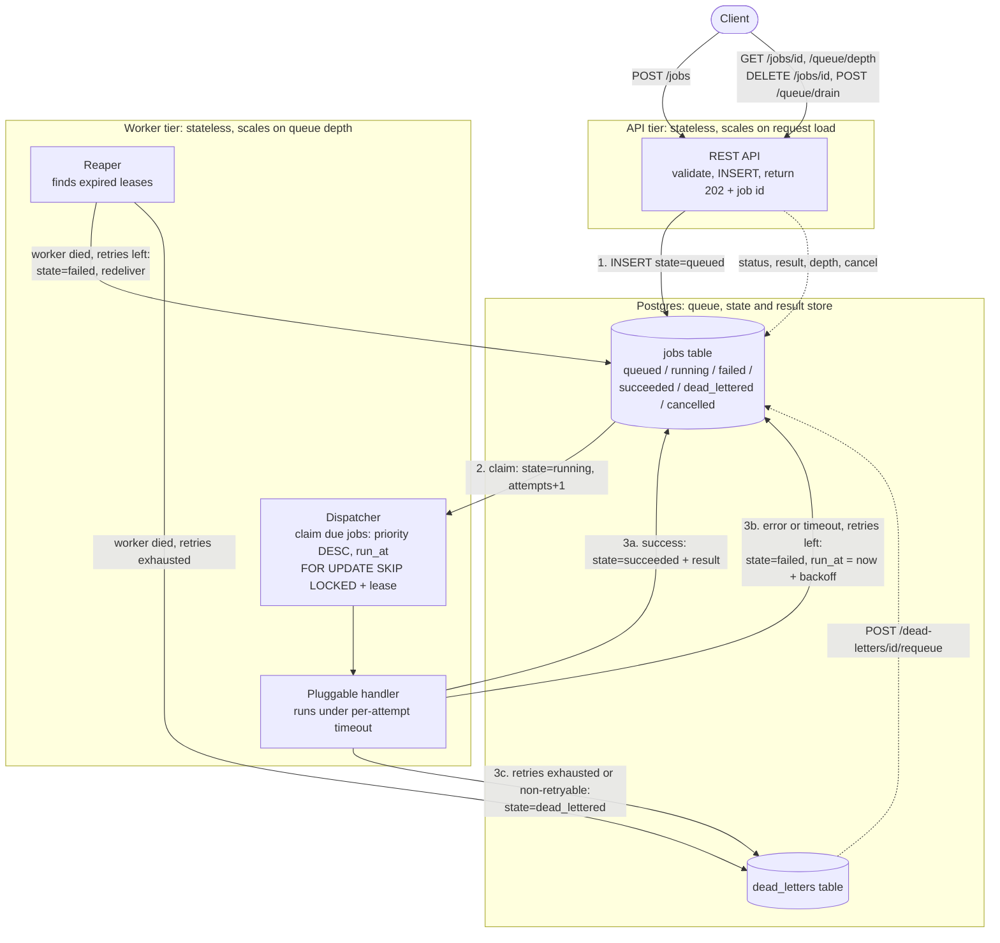
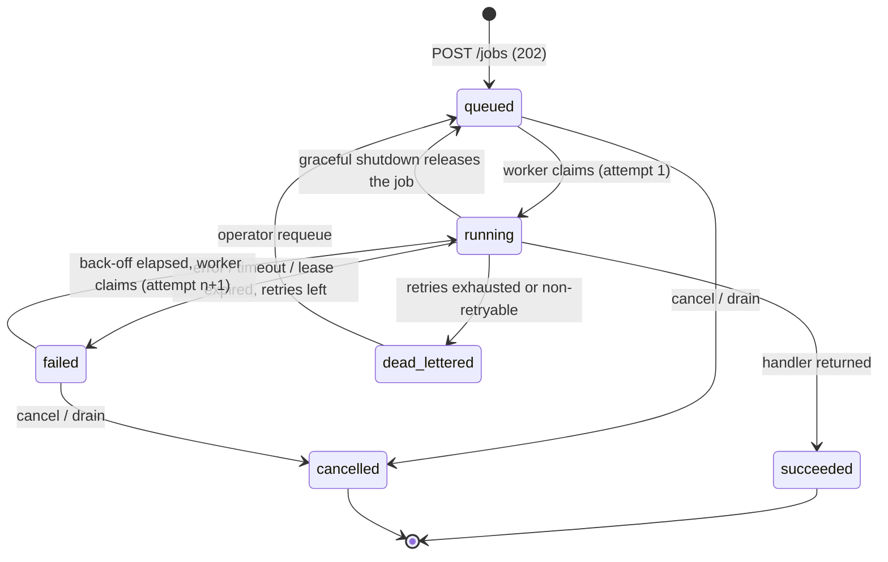

# Architecture

## Lifecycle flow

From HTTP submission, through the queue and the worker pool, to the result store, with the retry and
dead-letter paths.

Step 3c and both reaper paths update the job row and insert the dead-letter row in a single SQL
statement, so a job is never marked dead without a dead-letter record, or the reverse.

## Job state machine

`failed` is not terminal: it means "the last attempt failed and a retry is scheduled". The terminal
states are `succeeded`, `dead_lettered` and `cancelled`.

## Why one store

The queue, the in-flight state and the results live in one Postgres table, so every transition is one
atomic statement. There is no second system to keep consistent, which removes the dual-write problem a
separate broker introduces (job row committed but message never published, or the reverse).

The trade-off is throughput: all claims go through one Postgres primary. See "Handling high load" in the
README for the limits and for the broker-plus-outbox design that comes next.
